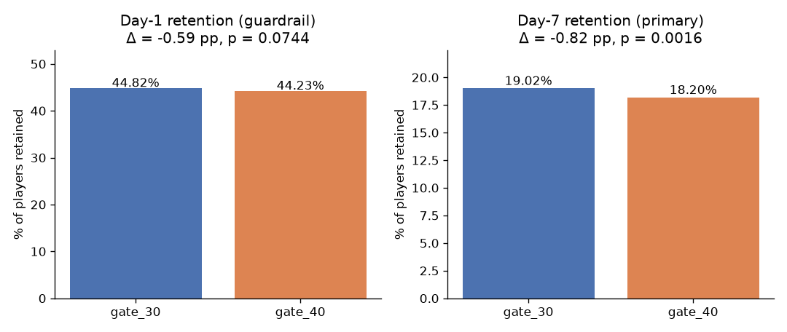
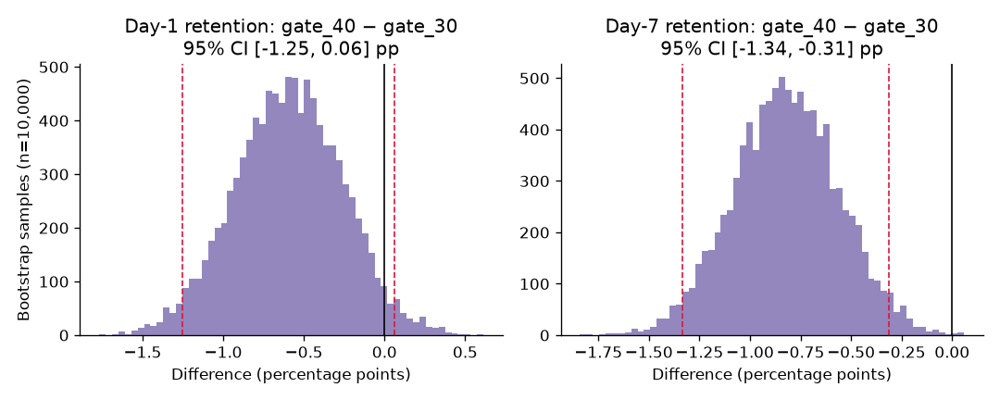
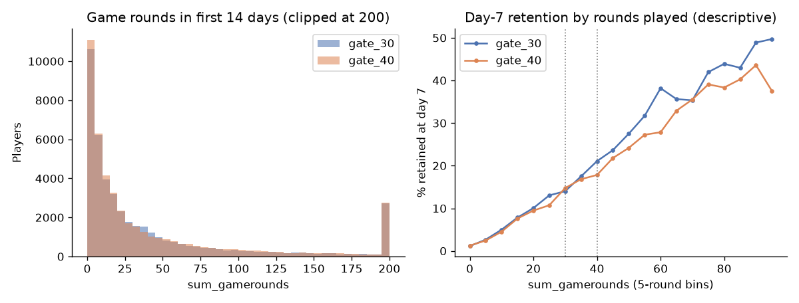
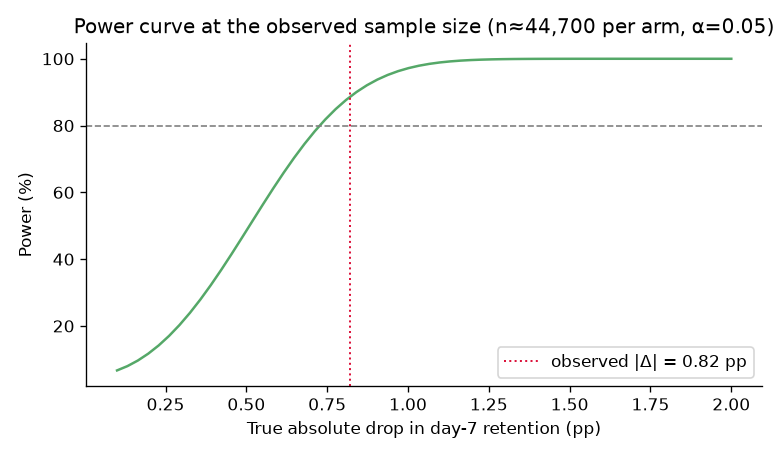

# Cookie Cats A/B Test: Should We Move the First Gate to Level 40?

A product data science readout of a real randomized experiment on **90,189 players** of the mobile puzzle game *Cookie Cats*. The project covers the whole workflow: experiment design, a sample ratio mismatch (SRM) check, frequentist and bootstrap inference, a nonparametric engagement analysis with outlier handling, power and minimum detectable effect (MDE), SQL metric definitions run in DuckDB, and a launch recommendation for a PM.

> **Recommendation: Don't ship.** Moving the gate from level 30 to level 40 lowers **7-day retention by 0.82 pp (19.02% → 18.20%, −4.3% relative; p = 0.0016; 95% CI −1.33 to −0.31 pp)**. The guardrails show no offsetting gain: day-1 retention moved in the same direction (−0.59 pp, p = 0.074) and engagement was flat.

---

## 1. Problem

In Cookie Cats, players hit a **gate** at certain levels. They must either wait or make an in-app purchase to keep playing. The gate gives players a forced break, and that break may help or hurt long-term retention. The experiment asks:

> Does moving the first gate from **level 30** (control, `gate_30`) to **level 40** (treatment, `gate_40`) change player retention?

## 2. Data

| | |
|---|---|
| Source | Cookie Cats A/B test dataset, made by Tactile Entertainment and popularized by the DataCamp project *Mobile Games A/B Testing with Cookie Cats* |
| Raw file used | [`ryanschaub/Mobile-Games-A-B-Testing-with-Cookie-Cats/cookie_cats.csv`](https://github.com/ryanschaub/Mobile-Games-A-B-Testing-with-Cookie-Cats/blob/master/cookie_cats.csv) (md5 `99b48ea3d4a552fa6b27aac60a8cfddf`) |
| Rows | 90,189 players, one row per player, no duplicates or missing values |
| Unit of randomization | Player (assigned when they installed the game) |

| Column | Meaning |
|---|---|
| `userid` | Player ID |
| `version` | `gate_30` (control) or `gate_40` (treatment) |
| `sum_gamerounds` | Game rounds played in the first 14 days after install |
| `retention_1` | Came back and played 1 day after install |
| `retention_7` | Came back and played 7 days after install |

A 2.7 MB copy of the CSV is committed in `data/`. `scripts/download_data.py` downloads it again and verifies the checksum. All credit for the data goes to its original authors. It is used here for educational purposes.

## 3. Experiment design

| Element | Choice |
|---|---|
| **Hypothesis** | H0: gate position has no effect on 7-day retention. H1: it does (two-sided). |
| **Primary metric** | 7-day retention (`retention_7`). This is the long-term health metric the gate is meant to affect. |
| **Guardrails** | 1-day retention (`retention_1`); engagement (`sum_gamerounds`) |
| **Validity check** | Sample ratio mismatch: chi-square test against the intended 50/50 split |
| **Significance** | α = 0.05, two-sided; target power 80% |
| **Decision rule** | Ship only if 7-day retention does not get significantly worse and no guardrail degrades |

## 4. Method

| Step | Technique | Code |
|---|---|---|
| SRM check | Chi-square goodness of fit vs 50/50 | `src/analysis.py::srm_check` |
| Retention effect | Two-proportion z-test + Wald 95% CI for the difference | `two_prop_test` |
| Robustness | Bootstrap (10,000 resamples) CI for the difference in retention | `bootstrap_rates` |
| Engagement | Mann-Whitney U, Welch t-test, bootstrap CIs for mean and median, after removing 1 extreme outlier; p99 winsorization as a sensitivity check | `engagement` |
| Power / MDE | `statsmodels` `NormalIndPower` (Cohen's h) at the observed n | `power_mde` |
| SQL metrics | Metric definitions in SQL, run with DuckDB | `sql/*.sql`, `src/run_sql.py` |

## 5. Key results

All numbers below come from `python src/analysis.py` and are saved in [`results/results.json`](results/results.json).

### 5.1 Sample ratio mismatch

| Variant | Players | Share |
|---|---|---|
| gate_30 | 44,700 | 49.56% |
| gate_40 | 45,489 | 50.44% |

χ² = 6.90, **p = 0.0086**. This check passes the strict p < 0.001 alarm threshold many experimentation platforms use. It is still below 0.05, though, and the imbalance is 789 players (0.9 pp). In production I would check the assignment and logging pipeline before signing off. Here the readout continues with this caveat noted, since an SRM can bias results in either direction.

### 5.2 Retention (primary and guardrail)



| Metric | gate_30 | gate_40 | Δ (pp) | Relative | z | p-value | 95% CI (Wald) | 95% CI (bootstrap) |
|---|---|---|---|---|---|---|---|---|
| **7-day retention (primary)** | 19.02% | 18.20% | **−0.82** | −4.31% | −3.16 | **0.0016** | [−1.33, −0.31] | [−1.34, −0.31] |
| 1-day retention (guardrail) | 44.82% | 44.23% | −0.59 | −1.32% | −1.78 | 0.074 | [−1.24, 0.06] | [−1.25, 0.06] |



In 99.92% of the bootstrap resamples, 7-day retention was higher in control than in treatment (96.53% for day-1 retention).

### 5.3 Engagement (game rounds, first 14 days)

The raw data has one player in `gate_30` with **49,854 rounds**. The next highest is 2,961 (`gate_30`) and the max in `gate_40` is 2,640. That one row is removed as a logging artifact. Game rounds are heavily right-skewed (median 16–17, p95 ≈ 220), so the main test is nonparametric.

| Statistic | gate_30 | gate_40 | Test | Result |
|---|---|---|---|---|
| Mean rounds (outlier removed) | 51.34 | 51.30 | Welch t-test | p = 0.95; bootstrap 95% CI for Δmean [−1.34, 1.33] |
| Median rounds | 17 | 16 | Mann-Whitney U | p = 0.051; bootstrap 95% CI for Δmedian [−1, 0] |
| Mean, winsorized at p99 (493) | 49.13 | 48.85 | Welch t-test | p = 0.63 |

Engagement is **flat**: the later gate did not make people play more.



*The right panel is descriptive only.* `sum_gamerounds` is measured after assignment, so splitting by it conditions on a post-treatment variable and is not a causal estimate. Still, the pattern is consistent with the main result: the retention gap opens mostly among players who reach roughly 40–100 rounds, which is the range where `gate_40` players hit their first gate later (`sql/04` shows 32.9% vs 29.4% 7-day retention in the 40–99 rounds bucket).

### 5.4 Power and minimum detectable effect



| Metric | Baseline | MDE at 80% power, α = 0.05 | n per arm to detect a 1 pp change |
|---|---|---|---|
| 7-day retention | 19.02% | **0.73 pp** (3.8% relative) | 23,685 |
| 1-day retention | 44.82% | 0.93 pp (2.1% relative) | 38,737 |

With about 45k players per arm, the test was well powered for the primary metric. The observed 0.82 pp drop is larger than the 0.73 pp MDE (post-hoc power at the observed effect ≈ 89%). So the significant result is not a fluke of an underpowered test. The day-1 guardrail effect (0.59 pp) is *below* its 0.93 pp MDE, so the guardrail's non-significant result should be read as "inconclusive, leaning negative," not as "no effect."

### 5.5 SQL metric layer (DuckDB)

The same metrics are defined in SQL so analysts and dashboards can reuse them. Run `python src/run_sql.py`. Outputs go to `results/sql_*.csv`.

| File | What it computes |
|---|---|
| [`sql/01_assignment_counts.sql`](sql/01_assignment_counts.sql) | Players and traffic share per variant (SRM input) |
| [`sql/02_retention_by_variant.sql`](sql/02_retention_by_variant.sql) | D1 / D7 retained counts and rates |
| [`sql/03_engagement_by_variant.sql`](sql/03_engagement_by_variant.sql) | Mean (raw and outlier removed), median, p95, max rounds, share with 0 rounds |
| [`sql/04_retention_by_engagement_bucket.sql`](sql/04_retention_by_engagement_bucket.sql) | D7 retention by engagement bucket and variant (descriptive) |

The SQL output matches the Python output exactly (e.g., D7 retention 0.1902 vs 0.1820).

## 6. Recommendation (PM summary)

**Decision: Do not ship `gate_40`. Keep the gate at level 30.**

- **Primary metric worse, and the result is statistically clear.** 7-day retention fell from 19.02% to 18.20% (−0.82 pp, −4.3% relative, p = 0.0016). The entire 95% CI is below zero (−1.33 to −0.31 pp), and the bootstrap agrees.
- **No offsetting win.** Day-1 retention also moved down (−0.59 pp, p = 0.074), and engagement was unchanged (mean 51.3 vs 51.3 rounds). Nothing on the other side of the ledger justifies the retention loss.
- **The test was adequately powered** (MDE 0.73 pp for D7), so this is a real signal and not noise.
- **Scale of impact:** at this effect size, for every 100,000 new installs about 820 fewer players would still be playing on day 7 (point estimate; plausible range ≈ 310–1,330).
- **Likely mechanism (hypothesis, not proven):** the earlier gate gives players a forced break before they burn out, so they come back more often. This matches hedonic-adaptation explanations commonly suggested for this experiment.
- **Caveats and follow-ups:** (1) investigate the borderline SRM (p = 0.0086) in assignment logs; (2) the data has no revenue or purchase information, so check that the gate's monetization impact doesn't change the decision; (3) a next test could try an *earlier* gate (e.g., level 20–25) or a softer gate.

## 7. Repository structure

```
ab-test-experimentation/
├── data/cookie_cats.csv            # public dataset (2.7 MB)
├── scripts/download_data.py        # re-downloads + checksum-verifies the data
├── src/analysis.py                 # full statistical readout -> results/ + figures/
├── src/run_sql.py                  # executes sql/*.sql with DuckDB
├── sql/                            # metric definitions in SQL
├── results/results.json            # every number quoted in this README
├── results/sql_*.csv               # SQL query outputs
├── figures/*.png                   # charts embedded above
├── requirements.txt
└── LICENSE (MIT)
```

## 8. How to run

```bash
git clone https://github.com/kedarnath30/ab-test-experimentation.git
cd ab-test-experimentation
python -m venv .venv && source .venv/bin/activate   # optional
pip install -r requirements.txt
python scripts/download_data.py   # verifies (or re-downloads) data/cookie_cats.csv
python src/run_sql.py             # SQL metrics via DuckDB
python src/analysis.py            # stats, power, figures -> results/ and figures/
```

The full run takes about 10 seconds. Random seeds are fixed (`SEED = 42`), so bootstrap intervals are reproducible.

---

*Author: Kedarnath Pandiri · License: MIT · Dataset credit: Tactile Entertainment / DataCamp.*
